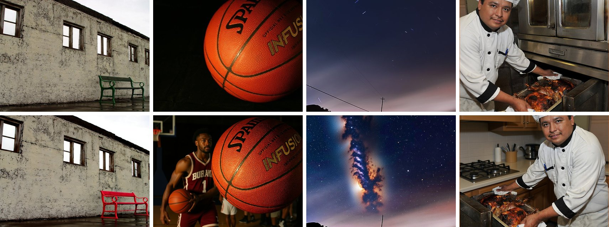
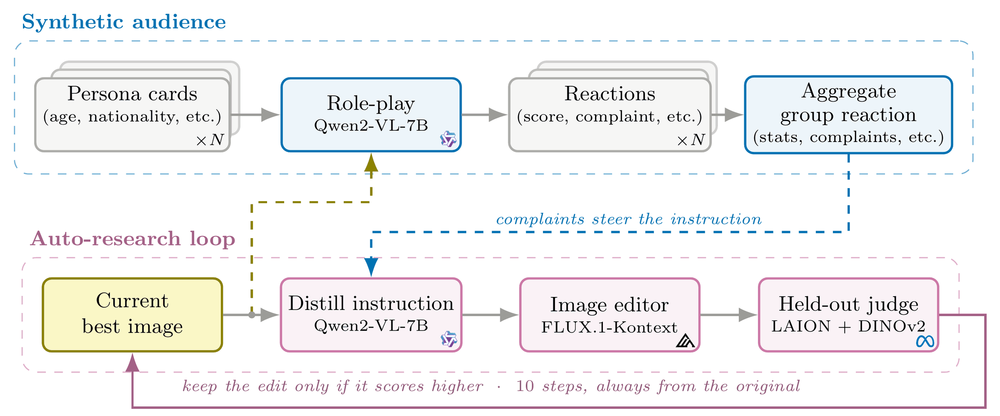

<div align="center">

# AutoPolish

### Improving Visual Aesthetics with Synthetic Audience Critique

**Amin Fadaeinejad**\* · **Sajjad Pakdamansavoji**\*<br>
Independent Research · \*equal contribution

<!-- Replace XXXX.XXXXX with the arXiv id once the paper is posted. -->
[](https://arxiv.org/abs/XXXX.XXXXX)
[](https://sajjadpsavoji.github.io/AutoPolish/)
[](https://huggingface.co/datasets/savoji/AUTOPOLISH)
[](LICENSE)
[](https://www.python.org/)



<sub>Top: source photographs. Bottom: the image AutoPolish keeps after ten rounds of critique by a simulated audience.</sub>

</div>

---

Text-guided image editing is a back-and-forth in which one person decides what to change, so the
result reflects that person's taste rather than the audience's. **AutoPolish** replaces that
person with a **synthetic audience**: many copies of one frozen vision-language model, each
reacting to the image as a different viewer described by a short profile. Their combined
complaints become edit instructions, and an independent scorer keeps an edit only if the image
scores higher and still resembles the original. Nothing is trained.

## Highlights

- **Groups are predictable, individuals are not.** Only 19–47% of one person's rating is shared
  with other viewers, while the averages of two separate groups agree at up to 0.96.
- **The audience tells viewer groups apart.** It separates them up to **10×** better than the same
  model without profiles (0.166 against 0.016 on paintings).
- **It transfers to AI-generated images.** On 898 pairs it agrees with the human majority
  **6 percentage points** more often than always picking the more popular model.
- **In editing it proposes more.** AutoPolish matches generic critics in average gain while
  keeping images recognizable, and proposes **3×** as many distinct changes per round.

## How it works



1. **Simulate the audience.** Each persona card describes a real rater from a public dataset.
   A frozen `Qwen2-VL-7B-Instruct` rates the image as that person and writes the one change they
   would want.
2. **Turn complaints into an edit.** The panel's complaints are condensed into one instruction
   of at most fifteen words, and `FLUX.1-Kontext-dev` applies the accumulated instruction to the
   **original** image, so artifacts cannot pile up.
3. **Keep only real improvements.** A LAION aesthetic predictor (a different model family from
   the critic) scores each candidate, and DINOv2 checks that it still resembles the original.
   The loop keeps an edit only if both checks pass, for ten rounds.

## Installation

```bash
git clone https://github.com/SajjadPSavoji/AutoPolish && cd AutoPolish
python -m venv .venv && source .venv/bin/activate

pip install -r requirements.txt     # analysis, figures and data download (CPU)
tools/setup_gpu.sh                   # adds torch and the model stack (GPU, optional)
```

The editor, `FLUX.1-Kontext-dev`, is a gated model: accept its license on the
[model page](https://huggingface.co/black-forest-labs/FLUX.1-Kontext-dev) and run
`huggingface-cli login` before the first edit.

## Quick start

The [playground notebook](notebooks/autopolish_playground.ipynb) runs a ten-persona panel and
one full editing round on the example images in `assets/examples/`, and reprints the paper's
headline numbers. In code:

```python
import sys; sys.path.insert(0, "src")
from PIL import Image
from persona import QwenVLBackend
from editor import SocietyCritic, distill_instruction

backend = QwenVLBackend("Qwen/Qwen2-VL-7B-Instruct")   # frozen, shared by every persona
panel = [
    "a female aged 30-34, education level: university; art experience: proficient; "
    "photography experience: competent.",
    "a male aged 18-21, education level: junior college; art experience: beginner; "
    "photography experience: beginner.",
    # ... one plain-text card per viewer
]
image = Image.open("assets/examples/basketball.jpg").convert("RGB")

critique = SocietyCritic(backend, panel).critique(image)
print(critique.panel_scores)        # one score per viewer
print(critique.complaints)          # the change each viewer wants
print(distill_instruction(backend, image, accumulated="", new_complaints=critique.complaints))
```

The full experiment, ten rounds on 100 photographs with four critics, is one command:

```bash
OUTPUT_ROOT=outputs/my_run tools/run_autopolish.sh
```

## Reproducing the paper

Every number and figure in the paper can be regenerated. The [reproduction guide](docs/REPRODUCING.md)
has three tiers, cheapest first:

| Tier | Needs | Time | Reproduces |
|---|---|---|---|
| 1 | CPU + experiment outputs (2.2 GB) | minutes | every figure and number |
| 2 | CPU + experiment outputs (2.2 GB) | ~1 hour | the analysis itself, from the raw run logs |
| 3 | GPUs + source datasets | days | the raw run logs, from scratch |

```bash
python tools/fetch_from_hf.py autopolish    # experiment outputs from the Hugging Face Hub
cd analysis && python paper_figs.py         # every paper figure -> results/paper_figs/
```

## Data

| | Source | Terms |
|---|---|---|
| PARA | [dataset page](https://web.xidian.edu.cn/ldli/en/dataset.html) | access on request |
| EVA | [kang-gnak/eva-dataset](https://github.com/kang-gnak/eva-dataset) | CC0-1.0 |
| LAPIS | [dataset page](https://sites.google.com/view/lapisdataset/homepage) | terms of use form |
| Rapidata | [Rapidata/700k_Human_Preference_Dataset_FLUX_SD3_MJ_DALLE3](https://huggingface.co/datasets/Rapidata/700k_Human_Preference_Dataset_FLUX_SD3_MJ_DALLE3) | CDLA-Permissive-2.0 |
| Our outputs | [savoji/AUTOPOLISH](https://huggingface.co/datasets/savoji/AUTOPOLISH) | analysis, run logs and edited images |

The source datasets are not redistributed here. [DATASETS.md](docs/DATASETS.md) explains how to
download them and where to put them.

## Repository layout

```
src/
  persona/        the synthetic audience: a frozen VLM role-plays one viewer at a time
  editor/         the AutoPolish loop: critics, FLUX editor, aesthetic scorer, similarity check
experiments/      drivers that run the models and write run logs
  {para,eva,lapis}_pipeline.py   replay each dataset's real raters as personas
  rapidata_pipeline.py           pairwise preferences on AI-generated images
  c4_refine.py                   the AutoPolish editing loop (the paper's main system)
  claim4_pipeline.py             the earlier self-refine loop the paper compares against
analysis/         CPU-only re-analysis of the run logs -> results/*.json and the paper figures
tools/            data download, GPU setup, the one-command editing run, website assets
notebooks/        autopolish_playground.ipynb, a hands-on tour
docs/             reproduction guide, datasets, GPU runbook, architecture
website/          the project page (GitHub Pages)
```

[ARCHITECTURE.md](docs/ARCHITECTURE.md) explains how the pieces fit together and the design
decisions behind them.

## Citation

```bibtex
@article{fadaeinejad2026autopolish,
  title   = {AutoPolish: Improving Visual Aesthetics with Synthetic Audience Critique},
  author  = {Fadaeinejad, Amin and Pakdamansavoji, Sajjad},
  journal = {arXiv preprint arXiv:XXXX.XXXXX},
  year    = {2026}
}
```

## License

The code is released under the [MIT License](LICENSE). The datasets and model weights it uses
keep their own licenses; in particular, `FLUX.1-Kontext-dev` is distributed under the
FLUX.1 [dev] Non-Commercial License.

## Acknowledgements

We thank the authors of PARA, EVA, LAPIS and the Rapidata preference dataset for releasing their
data, and the authors of Qwen2-VL, FLUX.1 Kontext, the LAION aesthetic predictor and DINOv2 for
their models.
